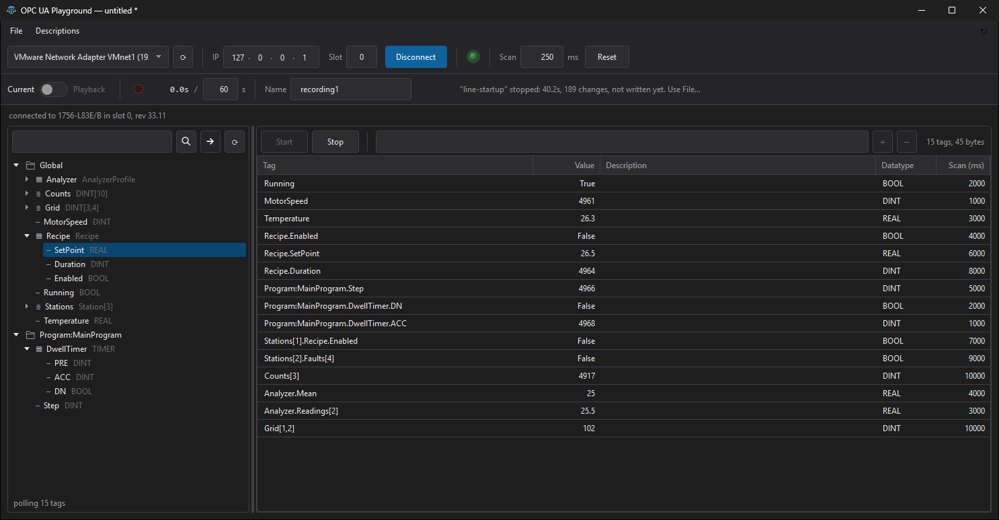
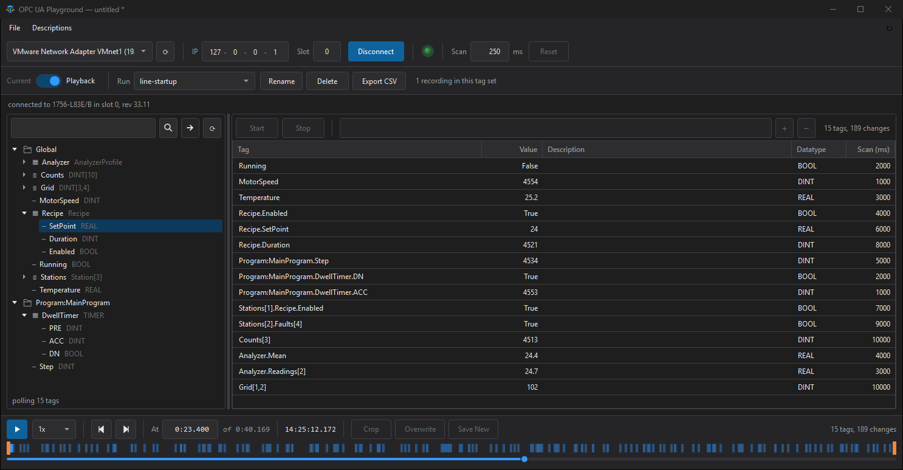

# OPC UA Playground

A faster alternative to Studio 5000 trends that doesn't require PLC software. Connect to a
ControlLogix or GuardLogix controller, select readable tags, import tag descriptions, and watch or
even record every change with a millisecond timestamp. Enter playback mode to scrub through your
recording and see exactly when each tag changes state.

It is **strictly read-only**. It never writes to a controller.





*Shown against the built-in simulator (`--simulate`), so the values are made up.*

- **Browse and monitor live tags:** BOOLs, DINTs, REALs, arrays and UDT members, each with its
  own scan rate.
- **Record changes, not samples:** each recording keeps only the moments a value changed, with a
  timestamp. A run stays small and every bit flip is easy to find.
- **Scrub through playback:** an activity strip marks every change in each tag's own color, and
  hovering a line lists the tags that changed there. Jump from one change to the next, crop a run
  and export it to CSV.
- **All data stays on your machine:** tag sets and recordings are saved as files on your
  computer, with no cloud and no account. The only time the app goes online is when you press the
  update button.
- **Read-only, one file, no install:** the app has no way to write to the controller, so it's
  safe to point at a running process. It's a single Windows exe that keeps itself up to date from
  GitHub.

> Despite the name, this is not an OPC UA client (yet). It talks to the controller directly over
> EtherNet/IP/CIP, the same protocol Studio 5000 and RSLinx use, so it works with any firmware
> and through a bridge module.

## Read-only by design

- Every request passes through a guard (`CipServices.AssertReadOnly`) before it reaches the
  socket. Only read services are allowed: Get_Attributes_All, Get_Attribute_List,
  Get_Attribute_Single, Read Tag and Get_Instance_Attribute_List, plus the Unconnected_Send and
  Multiple_Service_Packet services that carry them. Anything else, or anything the guard can't
  parse, is refused.
- There is no Write Tag and no Forward_Open, so the app never opens I/O connections.
- Nothing goes on the network until you press **Connect** (to the controller) or the **↻** update
  button (to GitHub, see [Updating](#updating)). Nothing is sent at startup.

Reading still puts load on the controller and its Ethernet module. Every tag in the table is read
at its scan rate, and the app asks before adding more than 500 tags at once.

## Features

- **Connect through a chassis.** Enter the address of the Ethernet module (or the controller) and
  the processor's slot. The app routes across the backplane to find the controller and shows its
  catalogue number and firmware revision.
- **Browse tags.** Controller and program tags, including UDT members and array elements, with a
  search box.
- **Monitor.** Add tags from the tree, or type a name (suggestions appear after three
  characters). Each row has its own scan rate.
- **Record.** Record every state change in the table for up to 999 seconds. A run records
  changes, not samples, so long quiet stretches cost nothing.
- **Play back.** Scrub through a run, play it at 0.25x to 10x, and jump from change to change. A
  strip under the bar shows where changes happened.
- **Tag colors.** Click the small swatch at the left of a row to give that tag its own color on
  the strip. Pick from a palette, a color wheel or RGB sliders, or type the R, G and B values. When
  tags with different colors change at the same moment, the line is split into a band for each.
  Every tag starts in the standard blue. Colors are saved in the tag set; the palette, including
  colors you save to it, is kept for you on this PC and can be reset.
- **Crop.** Keep only the part of a run that matters, either replacing the run or saving the
  crop beside it.
- **Export.** Write a run out as CSV, one row per instant.
- **Tag sets.** One `.tagset.json` file holds the table, every recording, and the controller it
  was made against, so it's easy to move or email. Opening one fills in the controller's address
  but never connects by itself.
- **Descriptions.** Load tag descriptions from a Studio 5000 tag CSV export. Controllers don't
  serve descriptions over the network, so the export is the only source.

## Requirements

- Windows 10 or 11, 64-bit.
- A network path to the controller or its Ethernet module (TCP port 44818).
- Nothing else. The download is self-contained and includes the .NET runtime.

## Install

1. Open the [Releases](../../releases) page and download `OpcUaPlayground-<version>-win-x64.zip`.
2. Extract it anywhere, for example `C:\Tools\OPC UA Playground`.
3. Run `OpcUaPlayground.exe`. Pin it or make a shortcut if you like.

The exe isn't code-signed, so Windows SmartScreen may say it "protected your PC" the first time.
Choose **More info → Run anyway**. Each release lists the file's SHA-256 so you can check the
download first:

```powershell
Get-FileHash .\OpcUaPlayground.exe -Algorithm SHA256
```

**To uninstall,** delete the folder, and optionally `%APPDATA%\OpcUaPlayground`, which holds only
the recent descriptions list and your color palette.

### Updating

Press **↻** at the right end of the menu bar. The app asks GitHub for the latest release and tells
you in the status bar if you're up to date. If a newer version exists, it offers **Update**, which:

1. downloads the release zip from this repository's Releases page,
2. checks it against the SHA-256 checksum GitHub publishes for it, and runs the new version's own
   self test,
3. asks about unsaved changes, as closing does, then swaps in the new exe and restarts.

If anything fails, nothing is installed and the current version keeps working. The app never
checks by itself, and only ever contacts `api.github.com` and GitHub's release downloads. You can
also update by hand: download the new zip and replace the exe.

## Quick start

1. Pick the **network adapter** that reaches the controller, then enter its **IP** and **Slot**.
   The IP is usually the chassis' Ethernet module (EN2T, EN4TR, ...); the slot is the processor's.
   For a CompactLogix, enter the controller's own IP and slot 0.
2. Press **Connect**. The light turns green once the controller has answered, and the tag tree
   fills in.
3. Choose tags in the tree and press the arrow, or type a name in the box above the table.
4. Press **Start** to begin polling.
5. To record, set the length in seconds and a name, then press the record light (it starts
   polling too, if it isn't running). Recording stops at the time limit, or press the light again
   to stop early.
6. Switch from **Current** to **Playback** to replay a run, then **Crop**, **Rename**, **Delete**
   or **Export CSV** as needed.
7. **File → Save** keeps the table and its recordings in a tag set file.

### Keyboard

| Where | Key | Does |
|---|---|---|
| Anywhere | Ctrl+N / Ctrl+O / Ctrl+S / Ctrl+Shift+S | New, Open, Save, Save as |
| Tag name box | Up / Down | Move through the suggestions |
| Tag name box | Enter or Tab | Fill in the highlighted suggestion |
| Tag name box | Enter (again) | Add the tag to the table |
| Tag table | Double-click a row | Copy its name into the box, e.g. to add the next array element |
| Tag table | Delete | Remove the selected rows |
| Tag tree | Shift+Up / Shift+Down | Extend the selection |
| Playback | Space | Play or pause |
| Playback | Left / Right | Previous or next state change |
| Playback | Home / End | Jump to the start or end |
| Playback | [ / ] | Put a crop handle at the playhead |

### Descriptions

In Studio 5000, export the tags to CSV (**Tools → Export → Tags and Logic Comments**). Then use
**Descriptions → From CSV** in this app. The five most recent files stay on the menu; one is
loaded at a time, and it stays loaded across restarts. Descriptions of UDT members live in the
data type rather than the tag export, so they may come through empty or show the parent tag's
text.

## Tested on

- ControlLogix: connecting, the chassis walk and browsing.
- GuardLogix 5580: day-to-day monitoring, recording, tag sets and description import.
- CompactLogix: expected to work, but not yet tested on hardware.

## Building from source

You need the [.NET 8 SDK](https://dotnet.microsoft.com/download/dotnet/8.0). There are no NuGet
packages; the EtherNet/IP stack is written from scratch.

```powershell
dotnet build OpcUaPlayground.csproj
```

To produce the single-file exe that the releases ship:

```powershell
dotnet publish -c Release -r win-x64 --self-contained true -p:PublishSingleFile=true -p:EnableCompressionInSingleFile=true -p:IncludeNativeLibrariesForSelfExtract=true
```

The output is `bin\Release\net8.0-windows\win-x64\publish\OpcUaPlayground.exe`.

### Self test and simulator

The exe has a few command-line switches for development:

| Switch | What it does |
|---|---|
| `--selftest` | Protocol and logic checks. Exit code 0 means everything passed. |
| `--simulate [empty\|big]` | A fake 1756 chassis on 127.0.0.1, for trying the app without hardware. `big` serves about 62,000 tags. |
| `--connect <ip> [slot]` | One connection attempt, printing what the status light would show. |
| `--browse <ip> [slot]` | Prints the tag tree. |
| `--watch <ip> [slot] [filter]` | Polls matching tags for 4 seconds and prints the values. |
| `--play <file> [run] [ms ...]` | Prints a recorded run's values at given moments. |
| `--update-feed <url>` | Points the update button at a test feed on this PC instead of GitHub. Loopback addresses only. |

To try the app without a controller, run `OpcUaPlayground.exe --simulate` in one window, then
start the app normally and connect to `127.0.0.1`, slot 0.

## Known limitations

- Read-only, always. There is no way to write a value or force anything.
- Arrays show at most 512 elements in the tree.
- Descriptions come only from a CSV export. The tab-separated TXT export isn't supported.
- Tag sets saved by 0.8.1 or later use file format version 4, which 0.8.0 and older can't open.

## Credits

App icon by [Icons8](https://icons8.com).
